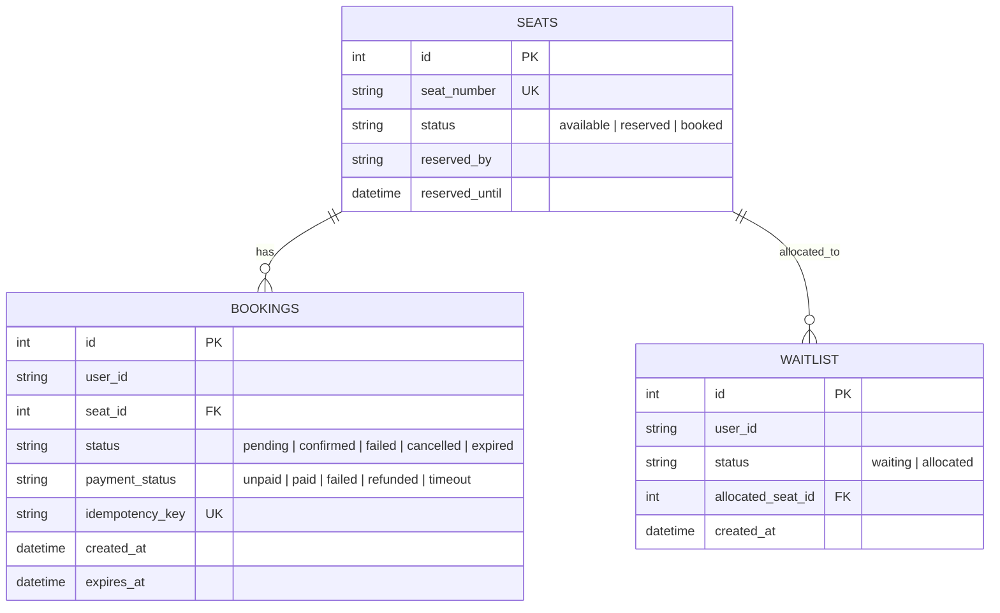
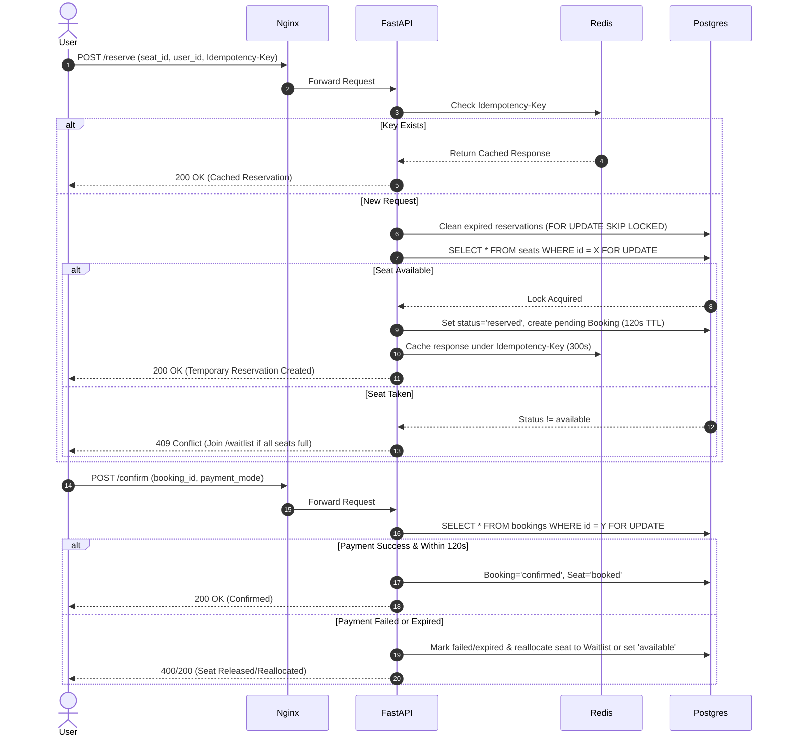

# The Last Seat - Concurrent Ticket Booking Backend

A high-concurrency concert ticket booking backend designed to handle thousands of simultaneous seat reservation requests for 500 available seats without double bookings or race conditions.

## Tech Stack & Implemented Features
- **Backend Framework:** FastAPI (Python 3.11)
- **Database:** PostgreSQL 15 (using pessimistic row-level locking)
- **Caching & Idempotency:** Redis 7
- **Reverse Proxy:** Nginx configured in front of 4 Uvicorn worker processes
- **Containerization:** Docker & Docker Compose
- **Load Testing:** Locust

### Assumptions Made
1. **Seat Initialization:** On startup, the system automatically seeds 500 seats (`S-1` through `S-500`) if the database is empty.
2. **Reservation Window:** Temporary seat reservations expire after **120 seconds (2 minutes)** if payment confirmation is not completed.
3. **Automatic Reallocation:** When a reservation expires, a payment fails, or a user cancels a confirmed booking, the system automatically checks the `waitlist` table. If a user is waiting in the FIFO queue, the seat is immediately reserved for them for 120 seconds; otherwise, the seat status returns to `available`.
4. **Authentication:** Since user auth was outside the core problem statement, `user_id` is passed in the request payload to simulate authenticated student sessions.

---

## System Diagrams

### 1. Entity Relationship Diagram (ERD)



### 2. Booking Workflow Diagram



---

## Concurrency Handling & Scaling Architecture

### How Double Booking is Prevented
1. **Pessimistic Row-Level Locking (`SELECT ... FOR UPDATE`):**
   When 500 students attempt to reserve `seat_id = 42` at the exact same millisecond, PostgreSQL serializes access to that specific row using `with_for_update()`. The first transaction to acquire the row lock changes `status` from `available` to `reserved` and commits. The remaining 499 transactions read the updated state (`reserved`) as soon as the lock releases and immediately exit with `409 Conflict`.
2. **Non-Blocking Expiration Cleanup (`FOR UPDATE SKIP LOCKED`):**
   Before processing reservations, expired holds are cleaned up using `with_for_update(skip_locked=True)`. This prevents cleanup operations from blocking active transactions or deadlocking under heavy load.
3. **Idempotency Keys via Redis:**
   Students on unstable connections often spam the "Reserve" or "Pay" button. Passing an `Idempotency-Key` header caches the transaction response in Redis (`idem:reserve:<key>` and `idem:confirm:<key>`). Repeated requests return the cached outcome without re-running database locks or double-charging the user.

### How the Application Can Scale to 100,000+ Users
1. **Horizontal API Scaling:** The FastAPI layer is stateless. Behind Nginx, we can scale from 1 container (with 4 Uvicorn workers) to dozens of containers across multiple nodes.
2. **Connection Pooling with PgBouncer:** High concurrency can exhaust PostgreSQL connection limits. Adding PgBouncer in transaction pooling mode multiplexes thousands of application connections over a small pool of physical database connections.
3. **Moving Hot Locks to Redis Lua Scripts:** For extreme flash-sale traffic (1M+ requests/min), seat availability bitmaps and temporary TTL locks (`SET seat:101 user_123 NX EX 120`) can be handled entirely in Redis memory, writing to PostgreSQL asynchronously via a message broker (RabbitMQ/Kafka) only when reservations succeed.
4. **Read Replicas:** High-volume `GET /seats` polling can be routed to PostgreSQL read replicas or served from a 1-second TTL Redis cache so read traffic never competes with write locks.

---

## Deployment Instructions

### Prerequisites
- Docker and Docker Compose installed

### Start the Stack
```bash
docker-compose up --build -d
```

The system will start:
- **PostgreSQL** on port `5432`
- **Redis** on port `6379`
- **FastAPI (4 workers)** behind **Nginx Reverse Proxy** on `http://localhost:8080`
- **Interactive Swagger Docs:** `http://localhost:8080/docs`

---

## Example API Requests

### 1. View Available Seats
```bash
curl -X GET "http://localhost:8080/seats?status=available"
```

### 2. Temporarily Reserve a Seat (with Idempotency Key)
```bash
curl -X POST "http://localhost:8080/reserve" \
  -H "Content-Type: application/json" \
  -H "Idempotency-Key: req-1001" \
  -d '{"user_id": "student_01", "seat_id": 1}'
```

### 3. Confirm Booking (Simulate Successful, Failed, or Delayed Payment)
**Success:**
```bash
curl -X POST "http://localhost:8080/confirm" \
  -H "Content-Type: application/json" \
  -H "Idempotency-Key: pay-1001" \
  -d '{"booking_id": 1, "user_id": "student_01", "payment_mode": "success"}'
```

**Failed Payment (Releases Seat):**
```bash
curl -X POST "http://localhost:8080/confirm" \
  -H "Content-Type: application/json" \
  -d '{"booking_id": 2, "user_id": "student_02", "payment_mode": "fail"}'
```

**Delayed Payment:**
```bash
curl -X POST "http://localhost:8080/confirm" \
  -H "Content-Type: application/json" \
  -d '{"booking_id": 3, "user_id": "student_03", "payment_mode": "delayed", "delay_seconds": 3}'
```

### 4. Cancel a Booking & Reallocate Seat
```bash
curl -X POST "http://localhost:8080/cancel/1?user_id=student_01"
```

### 5. Join Waiting Queue
```bash
curl -X POST "http://localhost:8080/waitlist" \
  -H "Content-Type: application/json" \
  -d '{"user_id": "student_99"}'
```

### 6. Check Booking Status & User Booking History
```bash
curl -X GET "http://localhost:8080/bookings/1"
curl -X GET "http://localhost:8080/bookings/user/student_01"
```

---

## Quick Concurrency Verification
To verify that the system prevents race conditions without running a full load test, a Python script is included.
1. Ensure the Docker containers are running (`docker-compose up -d`).
2. Run `python test_concurrency.py` (or `py test_concurrency.py` on Windows).

This script sends 50 simultaneous requests to reserve the exact same seat. You will see 49 requests safely rejected with a `409 Conflict`, and exactly 1 request succeed with a `200 OK`, proving the PostgreSQL pessimistic row-level locking works as expected.

---

## Load Testing & Concurrent Booking Results

### Running the Load Test
Run Locust in headless mode simulating **1,000 concurrent students** spawning at 100 users/sec hitting the Nginx reverse proxy:

```bash
py -m locust -f locustfile.py --headless -u 1000 -r 100 --run-time 1m --host http://localhost:8080
```

### Observed Results Summary (1,000 Concurrent Users / 60 seconds)

| Metric | Value |
| :--- | :--- |
| **Total Requests Processed** | 10,274 |
| **Successful Confirmations (`POST /confirm`)** | 593 (Includes waitlist re-allocations from failed payments) |
| **Rejected Concurrent Collisions (`409 Conflict`)** | 4,552 |
| **Routed to Waitlist Queue** | 1,281 |
| **Double-Booked Seats Detected** | **0** |

*Note: The 4,552 `409 Conflict` responses validate the database locking mechanism, as duplicate reservation attempts on already-locked rows are safely rejected.*